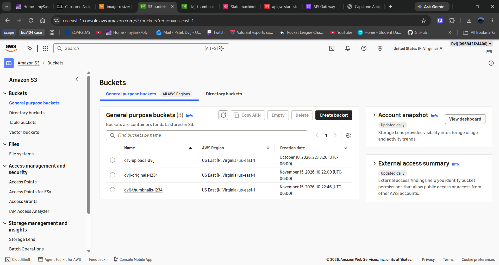
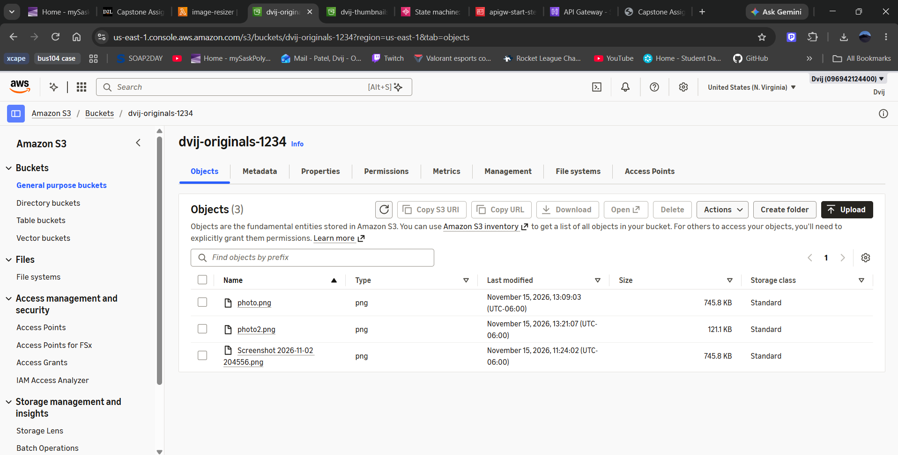
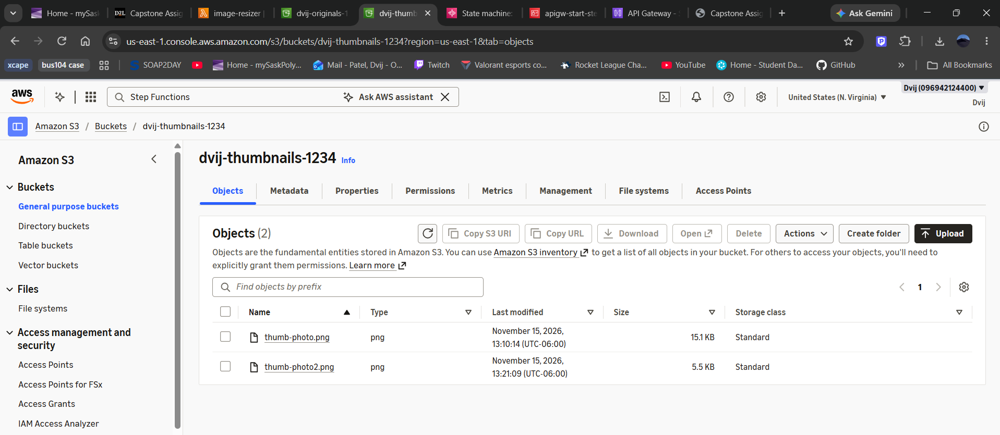
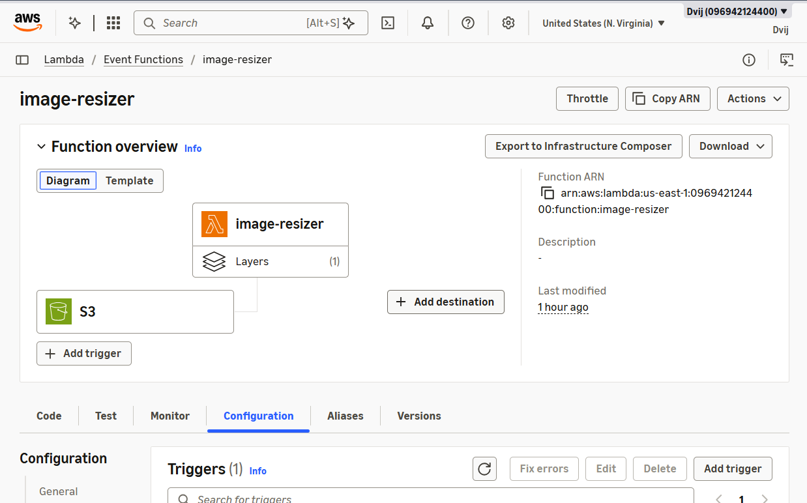
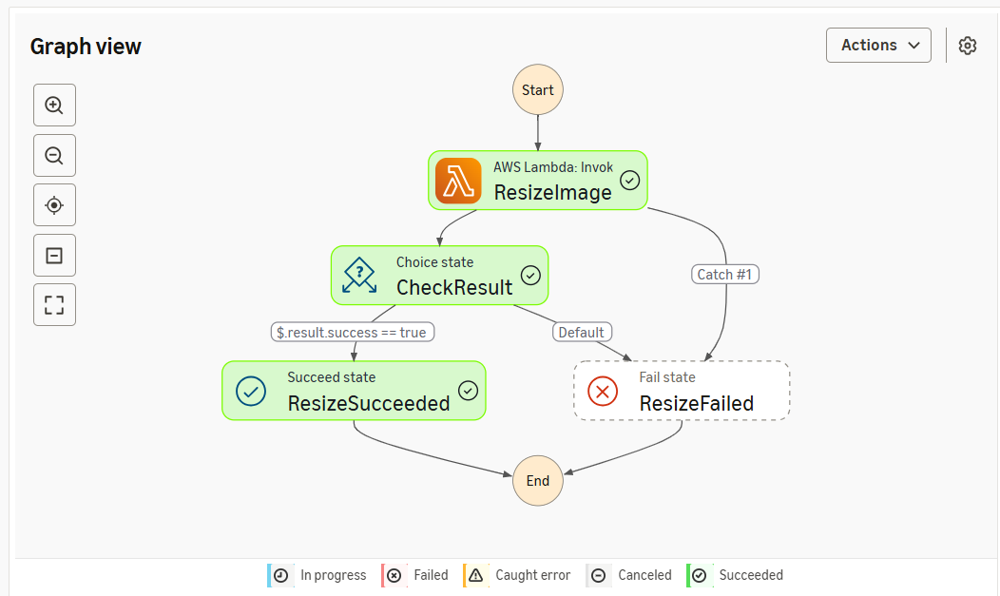
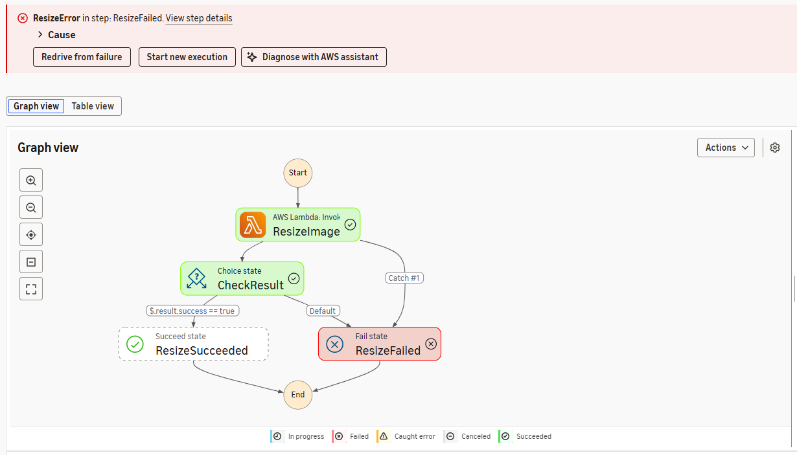
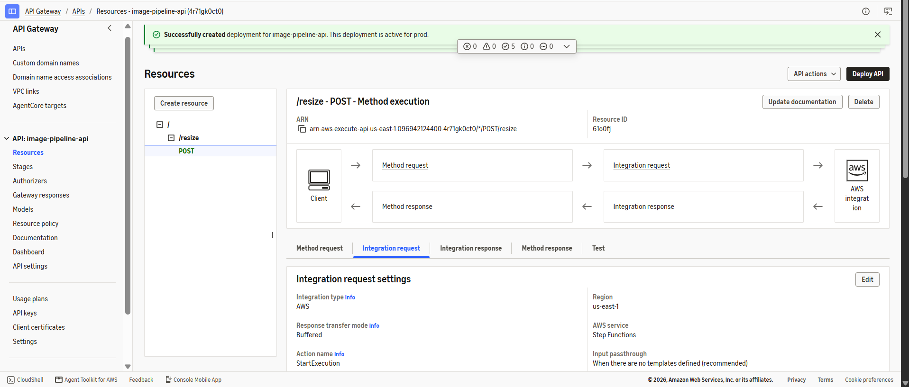

# Serverless Image Processing Pipeline

This is my CCMP-200 capstone project. It's a serverless app on AWS that makes thumbnails. When an image lands in an S3 bucket, a Lambda function shrinks it and saves the small version in a second bucket. A Step Functions workflow runs the resize and checks if it worked, and an API Gateway endpoint lets you start that workflow with a simple POST request.

## Architecture

```
API Gateway --> Step Functions --> Lambda --> S3 (thumbnails)
                     ^
                     |
                CloudWatch (logs)

S3 (originals) --upload--> Lambda   (automatic trigger)
```

## How it works

1. An image is uploaded to the originals bucket.
2. The S3 upload triggers the Lambda, which resizes the image to a max of 128x128 using Pillow.
3. The thumbnail is saved in the thumbnails bucket as `thumb-<original name>`.
4. You can also start the same process through the API. API Gateway starts the Step Functions state machine, which:
   - runs the resize Lambda,
   - checks the result in a Choice state,
   - ends in a Succeed state if the resize worked, or a Fail state if it didn't.
5. Logs for Lambda and Step Functions go to CloudWatch.

## What's in this repo

| Path | What it is |
|---|---|
| `lambda/lambda_function.py` | The resize Lambda (Python 3.12 + Pillow) |
| `stepfunctions/state_machine.json` | The state machine definition |
| `iam/lambda-s3-policy.json` | S3 permissions for the Lambda role |
| `iam/apigw-stepfunctions-policy.json` | Permission for API Gateway to start the state machine |
| `apigateway/mapping-template.vtl` | The VTL mapping template for the API |
| `screenshots/` | Screenshots of the working setup |

## Resources I used

| Resource | Name / value |
|---|---|
| Region | us-east-1 (N. Virginia) |
| Originals bucket | `dvij-originals-1234` |
| Thumbnails bucket | `dvij-thumbnails-1234` |
| Lambda function | `image-resizer` (Python 3.12, x86_64, 512 MB, 30 sec timeout) |
| Lambda layer | `pillow-layer-v2` (Pillow) |
| State machine | `image-processing-workflow` (Standard) |
| State machine ARN | `arn:aws:states:us-east-1:123456789012:stateMachine:image-processing-workflow` |
| API | `image-pipeline-api`, stage `prod` |
| API URL | `https://4r71gk0ct0.execute-api.us-east-1.amazonaws.com/prod/resize` |

The account ID in the ARN is replaced with `123456789012` on purpose.

## Prerequisites

- An AWS account
- Python 3 and pip on your computer (to build the Pillow layer)
- Everything is done in one region (I used us-east-1)

## Deployment steps

### 1. Create the S3 buckets
In S3, create two buckets. Bucket names are global, so pick your own unique names.
- originals: `dvij-originals-1234`
- thumbnails: `dvij-thumbnails-1234`

### 2. Build the Pillow layer
Pillow has native code, so it has to be built for Lambda's Linux. On Windows (PowerShell):

```powershell
mkdir python
pip install pillow --platform manylinux2014_x86_64 --only-binary=:all: --python-version 3.12 --implementation cp --target python
python -c "import shutil; shutil.make_archive('pillow-layer','zip',root_dir='.',base_dir='python')"
```

On Mac or Linux you can use `zip -r pillow-layer.zip python` for the last step.

Then in Lambda go to **Layers > Create layer**, upload `pillow-layer.zip`, and set the architecture to x86_64 and the runtime to Python 3.12.

### 3. Create the Lambda function
1. Create a function named `image-resizer` with Python 3.12 and **x86_64** architecture.
2. Add the Pillow layer.
3. Set memory to 512 MB and timeout to 30 seconds.
4. Add an environment variable `DEST_BUCKET` set to your thumbnails bucket name.
5. Paste in `lambda/lambda_function.py` and click Deploy.
6. Add an inline policy to the Lambda's role using `iam/lambda-s3-policy.json` (use your own bucket names).
7. Add an S3 trigger on the originals bucket for **All object create events**.

### 4. Create the Step Functions state machine
1. Create a **Standard** state machine named `image-processing-workflow`.
2. Paste in `stepfunctions/state_machine.json`.
3. Set logging to ALL so it goes to CloudWatch.

### 5. Create the API Gateway endpoint
1. Create an IAM role for API Gateway (trusted entity: API Gateway) with the policy in `iam/apigw-stepfunctions-policy.json`, using your real state machine ARN.
2. Create a REST API named `image-pipeline-api` with a resource `/resize` and a **POST** method.
3. Integration type: **AWS service**, service **Step Functions**, action **StartExecution**, and use the role from step 1.
4. In the integration request, add a mapping template for `application/json` using `apigateway/mapping-template.vtl` (use your real state machine ARN).
5. Deploy the API to a stage called `prod`.

## How to test it

**Option 1: upload to S3 (automatic)**
Upload a `.jpg` or `.png` to the originals bucket. After a few seconds a `thumb-<name>` file shows up in the thumbnails bucket.

**Option 2: through the API**
PowerShell:
```powershell
Invoke-RestMethod -Method Post -Uri "https://4r71gk0ct0.execute-api.us-east-1.amazonaws.com/prod/resize" -ContentType "application/json" -Body '{"bucket":"dvij-originals-1234","key":"photo.png"}'
```

Mac / Linux:
```bash
curl -X POST "https://4r71gk0ct0.execute-api.us-east-1.amazonaws.com/prod/resize" \
  -H "Content-Type: application/json" \
  -d '{"bucket":"dvij-originals-1234","key":"photo.png"}'
```

The image has to already be in the originals bucket. The response has an `executionArn`. Open the execution in the Step Functions console to see the result.

**Testing the failure path**
Use a key that doesn't exist, like `doesnotexist.png`. The workflow ends in the Fail state.

## Screenshots

**S3 buckets**



**Originals bucket**



**Thumbnails bucket**



**Lambda function with the S3 trigger and layer**



**Step Functions, successful run**



**Step Functions, failed run**



**API Gateway**



## Common problems

- `No module named PIL`: the layer isn't attached, or the zip doesn't have a top-level `python` folder.
- Can't import `_imaging`: the layer was built for the wrong platform, or the function is set to ARM64. Rebuild with the pip flags above and use x86_64.
- `AccessDenied` in the logs: the Lambda role is missing the S3 policy.
- `Missing Authentication Token` from the API: the URL is missing `/resize`, or the API wasn't deployed.

## Cleanup

To avoid charges, delete the API, state machine, Lambda, layer, and both buckets (empty them first).

## License

MIT
